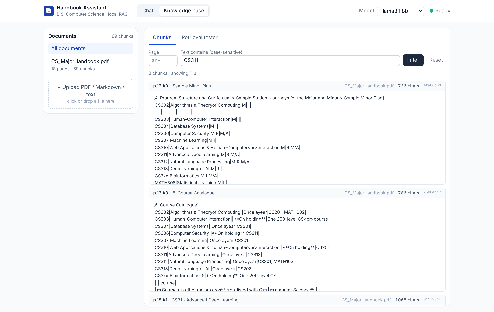
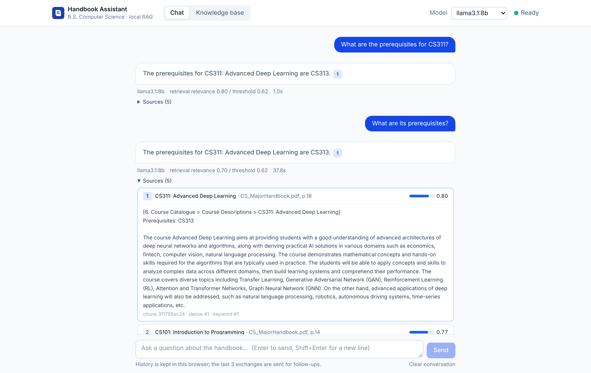
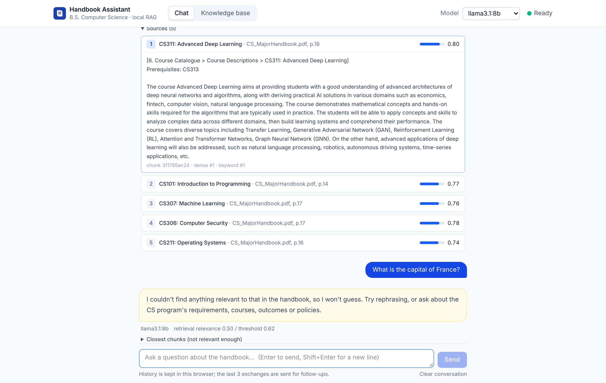
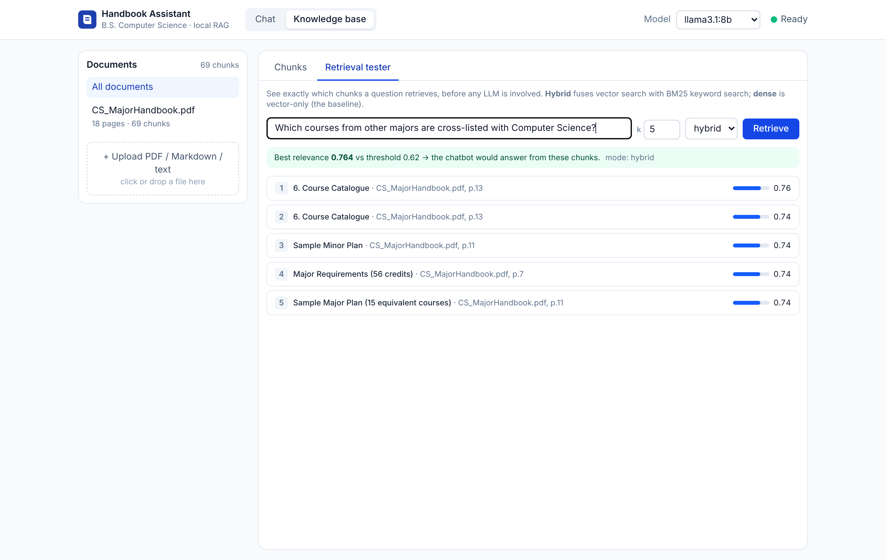

# 1. Introduction

Large language models answer fluently, but they know nothing about documents that were not in their training data, and when they lack an answer they tend to invent one. For a student asking about graduation requirements, a confident wrong answer is worse than no answer. Retrieval-Augmented Generation (RAG) addresses this by retrieving relevant passages from a document collection and asking the model to answer from those passages only. Running the whole pipeline locally keeps documents private, costs nothing per query and works offline.

The course provided a baseline, `run_txt.py`: a command-line script that indexes `.txt` files into ChromaDB with `nomic-embed-text` embeddings and answers with `qwen2.5:0.5b` through Ollama. In this project I extended that baseline into a deployable chatbot for the **B.S. Computer Science major handbook** (a 19-page PDF of about 5,500 words). The work covers the four implementation tasks:

- **Task 1 — PDF support:** structure-aware PDF parsing, chunking and indexing, through a CLI and through upload in the UI.
- **Task 2 — Handbook chatbot:** a grounded, cited chatbot, evaluated on a 30-question test set against the baseline.
- **Task 3 — Docker deployment:** a five-service Docker Compose stack, with the LLM running on the GPU inside a container.
- **Task 4 — Web UI:** a React chat interface with streaming answers, citations and history, plus a knowledge-base inspector.

Beyond the required tasks, I measured and fixed several weaknesses of the baseline: heading-aware chunking, nomic task prefixes, hybrid dense + keyword retrieval, a grounded citation prompt, and a calibrated relevance gate that refuses off-topic questions without calling the LLM. Each change is backed by a measurement in Section 4.

# 2. System architecture

<figure class="diagram">
<svg viewBox="0 0 860 300" xmlns="http://www.w3.org/2000/svg" font-family="Inter, Helvetica, Arial, sans-serif" font-size="13">
  <defs>
    <marker id="ar" viewBox="0 0 10 10" refX="9" refY="5" markerWidth="7" markerHeight="7" orient="auto-start-reverse"><path d="M0,0 L10,5 L0,10 z" fill="#475569"/></marker>
  </defs>
  <!-- ingestion lane -->
  <text x="10" y="22" font-weight="700" fill="#1e3a8a">Ingestion</text>
  <g fill="#eff6ff" stroke="#93c5fd">
    <rect x="10" y="34" width="110" height="46" rx="8"/><rect x="150" y="34" width="130" height="46" rx="8"/>
    <rect x="310" y="34" width="150" height="46" rx="8"/><rect x="490" y="34" width="150" height="46" rx="8"/>
  </g>
  <text x="65" y="55" text-anchor="middle">PDF / MD / TXT</text><text x="65" y="71" text-anchor="middle" fill="#475569" font-size="11">CLI or upload</text>
  <text x="215" y="55" text-anchor="middle">PyMuPDF parser</text><text x="215" y="71" text-anchor="middle" fill="#475569" font-size="11">markdown + ligature fix</text>
  <text x="385" y="55" text-anchor="middle">Heading-aware chunks</text><text x="385" y="71" text-anchor="middle" fill="#475569" font-size="11">1000/200 + breadcrumb</text>
  <text x="565" y="55" text-anchor="middle">nomic-embed-text</text><text x="565" y="71" text-anchor="middle" fill="#475569" font-size="11">search_document: prefix</text>
  <g stroke="#475569" stroke-width="1.5" marker-end="url(#ar)"><line x1="120" y1="57" x2="148" y2="57"/><line x1="280" y1="57" x2="308" y2="57"/><line x1="460" y1="57" x2="488" y2="57"/><line x1="640" y1="57" x2="698" y2="57"/></g>
  <rect x="700" y="30" width="150" height="56" rx="8" fill="#ecfdf5" stroke="#6ee7b7"/>
  <text x="775" y="54" text-anchor="middle" font-weight="600">ChromaDB</text><text x="775" y="71" text-anchor="middle" fill="#475569" font-size="11">cosine, 69 chunks</text>
  <!-- query lane -->
  <text x="10" y="130" font-weight="700" fill="#1e3a8a">Question answering</text>
  <g fill="#f8fafc" stroke="#cbd5e1">
    <rect x="10" y="142" width="120" height="56" rx="8"/><rect x="160" y="142" width="110" height="56" rx="8"/>
    <rect x="300" y="142" width="170" height="56" rx="8"/><rect x="500" y="142" width="150" height="56" rx="8"/>
  </g>
  <text x="70" y="166" text-anchor="middle">React UI</text><text x="70" y="183" text-anchor="middle" fill="#475569" font-size="11">question + 3 turns</text>
  <text x="215" y="166" text-anchor="middle">nginx → FastAPI</text><text x="215" y="183" text-anchor="middle" fill="#475569" font-size="11">stateless, SSE</text>
  <text x="385" y="166" text-anchor="middle">Hybrid retrieval</text><text x="385" y="183" text-anchor="middle" fill="#475569" font-size="11">dense 20 + BM25 20 → RRF → 5</text>
  <text x="575" y="166" text-anchor="middle">Relevance gate</text><text x="575" y="183" text-anchor="middle" fill="#475569" font-size="11">best cosine ≥ 0.62 ?</text>
  <g stroke="#475569" stroke-width="1.5" marker-end="url(#ar)"><line x1="130" y1="170" x2="158" y2="170"/><line x1="270" y1="170" x2="298" y2="170"/><line x1="470" y1="170" x2="498" y2="170"/></g>
  <line x1="775" y1="86" x2="420" y2="140" stroke="#475569" stroke-width="1.2" stroke-dasharray="4 3" marker-end="url(#ar)"/>
  <rect x="700" y="142" width="150" height="56" rx="8" fill="#f5f3ff" stroke="#c4b5fd"/>
  <text x="775" y="166" text-anchor="middle" font-weight="600">llama3.1:8b</text><text x="775" y="183" text-anchor="middle" fill="#475569" font-size="11">Ollama on GPU, temp 0.1</text>
  <line x1="650" y1="170" x2="698" y2="170" stroke="#16a34a" stroke-width="1.5" marker-end="url(#ar)"/><text x="674" y="162" text-anchor="middle" fill="#16a34a" font-size="11">yes</text>
  <line x1="575" y1="198" x2="575" y2="236" stroke="#dc2626" stroke-width="1.5" marker-end="url(#ar)"/><text x="588" y="222" fill="#dc2626" font-size="11">no</text>
  <rect x="490" y="238" width="170" height="44" rx="8" fill="#fef2f2" stroke="#fca5a5"/>
  <text x="575" y="258" text-anchor="middle">Refusal, no LLM call</text><text x="575" y="273" text-anchor="middle" fill="#475569" font-size="11">~0.05 s</text>
  <rect x="700" y="238" width="150" height="44" rx="8" fill="#f8fafc" stroke="#cbd5e1"/>
  <text x="775" y="258" text-anchor="middle">Cited answer [n]</text><text x="775" y="273" text-anchor="middle" fill="#475569" font-size="11">streamed to the UI</text>
  <line x1="775" y1="198" x2="775" y2="236" stroke="#475569" stroke-width="1.5" marker-end="url(#ar)"/>
</svg>
<figcaption>Figure 1. Ingestion (top) and question answering (bottom). All components run locally.</figcaption>
</figure>

The system has the same five stages as the baseline (documents → vector database → top-k chunks → LLM → response), but each stage was rebuilt:

| Stage | Choice | Why |
|---|---|---|
| Parsing | PyMuPDF via `pymupdf4llm`, emitting markdown; pypdf selectable in `.env` | Keeps headings and tables, which drive chunking and citations |
| Chunking | Split at headings, then `RecursiveCharacterTextSplitter` at 1000/200 characters; every chunk starts with a `[Section > Heading]` breadcrumb and stores page and heading | A chunk belongs to one section or course, and the breadcrumb puts the section name into the embedded text |
| Chunk IDs | SHA-1 of file hash + page + index | Re-ingesting an unchanged file does nothing |
| Embeddings | `nomic-embed-text` (137M parameters, 768 dimensions) with `search_document:` / `search_query:` prefixes | Small and fast; the prefixes are the model's documented usage |
| Vector store | ChromaDB server (its own container), cosine space | Cosine scores are interpretable, which the gate needs |
| Retrieval | Dense top-20 and BM25 top-20 (Snowball-stemmed), fused with Reciprocal Rank Fusion (k = 60); top 5 go to the LLM | Exact course codes and terms are matched by BM25, paraphrases by the dense retriever |
| Gate | Best cosine of the current question's top chunks must reach 0.62, otherwise refuse | Off-topic questions never reach the LLM |
| Generation | `llama3.1:8b` (default) or `qwen2.5:0.5b`, temperature 0.1, `num_ctx` 8192, streamed over Server-Sent Events | Near-deterministic, grounded answers |
| API / UI | FastAPI (stateless; history comes from the client); React + Vite + Tailwind served by nginx | Clean separation so the UI and the API can scale independently |

The repository is a monorepo: `source_code/backend/rag` holds the RAG core and has no FastAPI imports, so the ingestion CLI, the API and the evaluation scripts all share one implementation.

# 3. Task 1: PDF support

The baseline loaded only `*.txt`. The new loader dispatches on file suffix (`.pdf`, `.md`, `.txt`). Documents enter in three ways: the CLI `python -m rag.ingest <files|dirs> [--reset] [--parser]`, automatic ingestion when the API starts with an empty collection, and upload (button or drag-and-drop) in the web UI. Ingestion embeds new chunks before swapping them in, so a failure (for example, Ollama being down) never deletes the existing index — the first version did exactly that, which is how I learned to order it this way.

**Parser choice.** I compared the two parsers on the handbook. pypdf returns flat text; with the baseline's plain splitter it produced **55 chunks** that often mixed the end of one section with the start of the next. PyMuPDF returns markdown with `#` headings and tables; with heading-aware splitting it produced **69 smaller chunks**, each belonging to one section or one course. PyMuPDF's layout analysis is slower (about 25 s for the handbook on CPU, versus near-instant for pypdf), but ingestion happens once, so I made it the default.

**PDF quality problems found with the chunk inspector.** Looking at the raw chunks (Figure 2) revealed two problems that no prompt tweak could have fixed:

1. *Broken ligatures.* The handbook was exported from macOS Quartz, and the "tt"/"ti" ligatures extract as `0`, `2`, `8`, `;` or `'` — "A0ributes", "Descrip8on", "Educa;onal", "Founda'onal". I repair them with targeted regular expressions that deliberately leave course codes such as `CS2xx` and `MATH103` alone, and unit tests cover both cases.
2. *Bold course titles.* Some course titles are bold text rather than headings (`**CS307: Machine Learning**`), so the Machine Learning description was labelled "CS306: Computer Security" and its citations would have pointed at the wrong course. The chunker now also treats a bold line starting with a course code as a heading (unit-tested).

Two problems remain: table cells lose spaces ("Once ayear", "DeepLearning"), and page 10 is an image of the curriculum diagram, so it yields no text — only 18 of the 19 pages produce chunks. Recovering it would need OCR, which the assignment FAQ notes is outside the default scope.

# 4. Task 2: Handbook chatbot and evaluation

## 4.1 Test set

I wrote 30 questions (`source_code/test/eval/questions.json`) covering the handbook: 10 on requirements and policies, 8 on courses, 6 on learning outcomes and other topics, 1 tricky question, 2 in-domain questions the handbook cannot answer (tuition, head of department), 1 off-topic question, 1 question in Vietnamese and 1 follow-up that depends on the previous turn. Each question has an expected answer, key facts, and an evidence string from the handbook used to score retrieval automatically.

## 4.2 Retrieval ablation

For the 27 answerable questions, a retrieval "hit" means one of the top-5 chunks contains the evidence string. I added the improvements one at a time:

| Configuration | hit@1 | hit@5 | MRR |
|---|---|---|---|
| A: baseline (pypdf, plain chunks, no prefix, L2) | 11/27 | 20/27 | 0.540 |
| B: + PyMuPDF heading-aware chunks (dense) | 18/27 | 23/27 | 0.723 |
| C: + nomic task prefixes (dense) | 18/27 | 23/27 | 0.725 |
| D: + hybrid BM25 / RRF, stemmed (**shipped**) | 17/27 | **25/27** | **0.760** |

- **Document structure was the biggest win.** hit@1 rose from 11 to 18. "How many credits are required?" (56), "Which language is used in CS201?" (Java) and "Which universities was the curriculum modelled on?" went from not retrieved to rank 1, because each chunk now carries its section name and sections no longer bleed into each other.
- **The nomic prefixes changed almost nothing** (MRR 0.723 → 0.725). This is an honest negative result: a documented best practice gave no measurable gain on this small corpus. I kept them because they cost nothing.
- **Hybrid retrieval** rescued two exact-term questions — the honors policy and the cross-listed courses (MATH308, ENG301) — from "miss" to rank 2, and improved three others. The cost is that one question (R2) dropped from rank 1 to rank 5, so hit@1 fell by one: better recall, slightly worse precision at the top.
- Hybrid search initially made "How are students assessed?" *worse*: BM25 had no stemming, so "assessed" did not match "assessment" and generic words dominated. Adding a Snowball stemmer fixed it. I found this with the UI's retrieval tester (Figure 5).
- Two questions are missed by every configuration: the list of Core courses (R10), which sits in a numbered list whose wording does not match the question, and the Vietnamese question (V1), which the English-only embedder cannot match.

## 4.3 The relevance gate

**The baseline's gate never fires.** The baseline averages `1/(1 + L2 distance)` over the top-5 chunks and falls back to "general knowledge" below 0.3. Because nomic embeddings are close to unit length, the L2 distance is at most 2, so the score is at least 1/3 by construction. Measured over all 30 questions, the score ranged from **0.453 to 0.691** and the fallback fired **0 times out of 30** — even "What is the capital of France?" scored 0.453. Meanwhile the baseline prompt told the model it *could* use general knowledge, which is how it answered "Paris" and invented a tuition structure.

**The new gate** uses the best cosine similarity between the *current* question and its retrieved chunks, compared with a threshold I calibrated from measured scores rather than guessed:

| Question set | Best-cosine scores | Outcome at 0.62 |
|---|---|---|
| English handbook questions | min 0.636 (R8), median ≈ 0.79 | none refused |
| Vietnamese question (V1) | 0.546 | refused (retrieval had failed anyway) |
| In-domain but unanswerable (tuition, department head) | 0.667, 0.660 | pass; the prompt must decline |
| Clearly off-topic (10 questions) | 0.458 – 0.638 | 8 of 10 refused |

The distributions overlap, so the gate is a cheap first filter, not a guarantee. The two off-topic questions that passed ("recommend a laptop", "explain transformers") were declined by llama3.1:8b's grounded prompt, the second line of defence.

During calibration I found a bug: the gate originally scored the *history-augmented* retrieval query, so an off-topic question asked right after a handbook question inherited its relevance ("World Cup" scored 0.704 and "sourdough" 0.737, both passing). The gate now scores the current question alone, while retrieval still uses the combined query so that follow-ups work. I also found that scores depend on the runtime: the host's Ollama 0.21 scored off-topic text about 0.1 higher than the container's 0.40.16, so the threshold must be re-calibrated whenever Ollama or the embedding model changes.

## 4.4 Answer quality

I ran the full test set through three setups. The automatic "facts" column is a string match and is unreliable (it marks the baseline's list of five languages, one of which is Java, as correct), so I also graded every answer of the default model by hand.

| Setup | Facts matched (27) | Unanswerable declined (3) | Wrongly refused | Valid citations | Median latency |
|---|---|---|---|---|---|
| Baseline: qwen2.5:0.5b, temp 0.7, general-knowledge fallback | 13 | **0** | 0 | no citations | 6.6 s |
| Final pipeline + qwen2.5:0.5b | 13 | 2 | 1 | 3/26 | 7.9 s |
| Final pipeline + **llama3.1:8b** (default) | **23** | **3** | 1 | **26/26** | **1.6 s** |

Manual grades for the default setup (llama3.1:8b, all 30 questions):

| Grade | Count | Questions |
|---|---|---|
| Correct | 22 | 19 answerable questions, plus all 3 unanswerable ones correctly declined |
| Incomplete | 4 | R2, R6, C4, O4 |
| Ambiguous | 2 | T1, R8 |
| Incorrect | 2 | R10, V1 |

**Correct.** "What are the prerequisites for CS311?" → *"The prerequisites for CS311: Advanced Deep Learning are CS313. [1]"*. The follow-up test asked about CS313 and then "What are its prerequisites?"; the system answered *"CS208 [1]"*, showing that history-aware retrieval resolves the pronoun. All three unanswerable questions were declined with the exact sentence "I couldn't find this in the handbook." or refused by the gate.

**Incomplete.** Asked what can replace the Capstone (R6), the model named two of the three alternatives and omitted that skipping the Capstone means graduating without honors. For courses "on holding" (C4) it listed four of five, missing CS210, because the catalogue table is split across chunks. For assessment (O4) it listed only summative methods and missed the formative-assessment principle. For required courses (R2) it listed the named courses but not the "three intermediate / four advanced" slots.

**Ambiguous.** The tricky question (T1) asks which degree is awarded. The handbook's Degree Requirements section literally says "Bachelor of Science in Applied Mathematics" — an apparent copy-paste error in the source — and the model faithfully repeated it. The system was faithful to a wrong document, which RAG cannot detect. For the honors question (R8), the model hedged ("it does not explicitly state…") although the handbook implies the answer is no: cautious and partly right.

**Incorrect.** For the Core courses (R10), retrieval missed the list; the model correctly said the courses were not listed but then claimed one of them was "Introduction to CS", an unsupported statement. The Vietnamese question (V1) was refused by the gate because retrieval failed. Both are retrieval failures surfacing in the answer.

**What the comparison shows.**

- **The pipeline fixes safety.** The baseline answered all three unanswerable questions: it said "Paris", invented a tuition structure, and named "CS Major Handbook" as the head of department. The final pipeline declined all three.
- **Model size drives accuracy and instruction-following.** qwen2.5:0.5b with the same retrieval and prompt produced only 3 valid citations out of 26. It often pasted raw excerpts instead of answering, said "Yes, you can graduate with honors" without the Capstone (wrong), and once looped, listing "CS 314, CS 315, … CS 348" for 994 seconds. llama3.1:8b cited validly every time.
- **The larger model was also faster.** llama3.1:8b runs at about 53 tokens/s fully on the GPU and gives short grounded answers, while qwen rambles, so llama's median latency (1.6 s) beat qwen's (7.9 s).

# 5. Task 3: Docker deployment

`docker compose -f docker/compose.yml up -d --build` starts the whole system:

| Service | Image | Role |
|---|---|---|
| `frontend` | nginx + built React app | UI on `http://localhost:3000`; proxies `/api` to the API |
| `api` | python:3.12-slim + uv | FastAPI, ingestion, retrieval and prompting |
| `chroma` | chromadb/chroma:1.5.9 | Vector store on a named volume |
| `ollama` | ollama/ollama:0.40.16 | Embedding and LLM inference on the GPU |
| `ollama-init` | ollama/ollama:0.40.16 | One-shot job that pulls the required models |

Models and vectors live in named volumes, and the handbook and uploads are bind-mounted, so data survives container rebuilds. Two override files cover other machines: `compose.cpu.yml` removes the GPU reservation for hosts without an NVIDIA GPU, and `compose.dev.yml` runs only ChromaDB in Docker while the API and the Vite dev server run on the host against the host's Ollama, with hot reload.

**GPU inside a container.** The assignment does not require the LLM to run in Docker — the baseline uses Ollama on the host — but a fully containerised stack is more portable and reproducible, so I chose it. My machine runs Fedora 44 with SELinux enforcing and an RTX 5050 (Blackwell, compute capability 12.0). I installed the NVIDIA Container Toolkit and generated a Container Device Interface (CDI) specification, then granted the GPU with `devices: [nvidia.com/gpu=all]`. The commonly documented `--gpus all` and `driver: nvidia` forms failed on this setup because they need the legacy NVIDIA runtime; CDI needed no Docker daemon change and no SELinux workaround. I verified that Ollama detects the GPU with its CUDA 13 libraries and offloads all model layers (100% GPU). The trade-offs: about 5.6 GB of models are downloaded again into the container's volume, and the host Ollama service must be stopped to free the 8 GB of VRAM. The full procedure is in `docs/gpu-setup-notes.md`.

# 6. Task 4: User interface

The web interface (React, Vite, TypeScript and Tailwind, served by nginx) has two pages.

**Chat** (Figures 3 and 4). Answers stream token by token. Each `[n]` citation is a chip that expands the exact source chunk with its file, page, heading breadcrumb and score. Under each answer the UI shows the model, the retrieval relevance against the threshold, and the latency. A model picker switches between the allowed models. History is stored in the browser and the last three exchanges are sent with each question; Stop and Clear buttons complete the controls. Refusals are shown in a distinct style with the closest (insufficiently relevant) chunks available for inspection.

**Knowledge base** (Figures 2 and 5). It lists the indexed documents with upload and delete, and has two tools I used constantly during development: a chunk browser (filter by page or text, showing raw chunk text and metadata) and a retrieval tester that shows the top-k chunks for any question, with cosine scores, dense and BM25 ranks, and whether the chatbot would answer or refuse. The parsing bugs in Section 3 and the stemming bug in Section 4.2 were both found with these tools.

# 7. Prompt design

The baseline prompt invited hallucination: *"If the context is insufficient, use your general knowledge"*, at temperature 0.7. My system prompt (`backend/rag/generation.py`) reverses that:

1. Answer only from the numbered excerpts; no outside knowledge.
2. Cite the excerpt number after every sentence that uses it, e.g. `[1]` or `[2][3]`.
3. If the excerpts do not contain the answer, reply exactly "I couldn't find this in the handbook."
4. If they only partly answer, give the supported part and say what is missing.
5. Be concise; use a short list for courses or requirements.
6. Reply in the language of the question.
7. Use earlier turns only to resolve references such as "it" or "that course".

Each excerpt is labelled with its number, file, page and heading, and the temperature is 0.1. The evaluation shows that the prompt is only as good as the model following it: llama3.1:8b followed rules 1–3 in every case I tested, while qwen2.5:0.5b ignored the citation format, sometimes printed the excerpt headers verbatim, and still produced unsupported claims.

# 8. Limitations and failure cases

- **Tables are fragile.** Table rows are linearised and lose spaces, and long tables are split across chunks, so list-from-a-table questions (C4) come back incomplete.
- **No OCR.** The curriculum diagram on page 10 is invisible to the system.
- **English-only embeddings.** The bot can reply in Vietnamese, but Vietnamese questions retrieve poorly and are refused.
- **Relevance is not correctness.** The gate measures whether relevant text was found, not whether the answer is right; a passing question can still get a wrong or incomplete answer (R10).
- **The source can be wrong.** The system faithfully repeats errors in the handbook (T1).
- **Small models ignore instructions,** and there is no output-length cap, so a looping model can run for minutes.
- **Single-user prototype.** The BM25 index lives in memory, and there is no authentication or multi-user support.

# 9. Lessons learned and future work

- **Look at the chunks before tuning the LLM.** The chunk inspector exposed the ligature and bold-heading bugs; no prompt change would have fixed them.
- **Measure the baseline's assumptions.** The baseline's relevance gate looked reasonable but was mathematically unable to fire.
- **Measure, don't assume.** The documented nomic prefixes gave about +0.002 MRR here, while document structure gave +0.18.
- **History helps retrieval but must not leak into the gate,** as the off-topic follow-up bug showed.
- **Hybrid search needs basic IR hygiene.** Without stemming, BM25 made one question worse.
- **Thresholds are runtime-specific.** An Ollama upgrade shifted cosine scores by about 0.1.
- **Order destructive steps carefully.** Embed first, then swap, so a failed ingest never empties the index.

Future work: LLM-based query rewriting for follow-ups, a cross-encoder reranker to recover precision at rank 1, table-aware chunking, a multilingual embedder such as `bge-m3`, a `num_predict` cap on generation, OCR for image pages, and automatic LLM-as-judge evaluation to replace manual grading.

# 10. Conclusion

Starting from a text-only command-line baseline, I built a local RAG system that ingests PDFs with their structure, answers questions about the CS major handbook with verifiable citations, refuses what it cannot ground, and runs as a GPU-accelerated Docker Compose stack behind a web interface. The evaluation showed that the largest gains came from unglamorous data work — clean parsing and section-aware chunks raised hit@1 from 11 to 18 of 27 — and from choosing a model strong enough to follow grounding instructions. With llama3.1:8b, the final system answered 19 of 27 answerable test questions fully correctly, declined every unanswerable one, and cited validly every time, where the baseline confidently answered questions it had no source for.

# Appendix

- **Repository:** <https://github.com/Thai-Anh-Nguyen/Local-RAG-System> — installation, Docker deployment and usage are in the README.
- **Demo videos:** Task 1 (PDF processing), Task 2 (handbook chatbot), Task 3 (Docker deployment), Task 4 (web interface) — links: *[add links]*.
- **Evaluation artefacts:** `report/eval/` contains the per-question retrieval ranks, all answers from the three setups, the gate calibration and the raw `results.json`.
